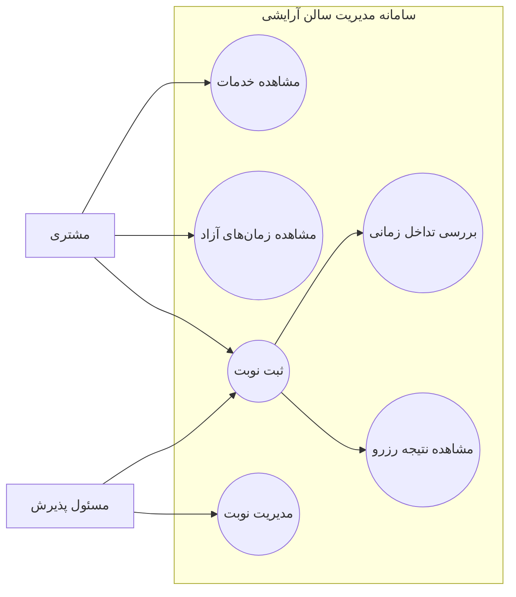
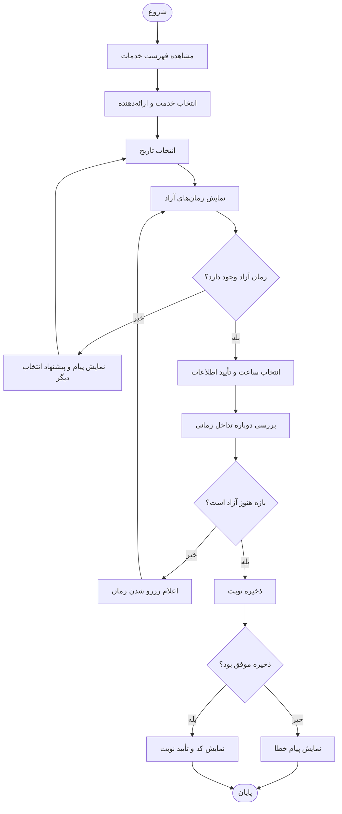

# جلسه سوم: مدل‌سازی نیازمندی‌ها و UML

**موضوع پروژه:** سیستم مدیریت سالن آرایشی  
**فرایند انتخاب‌شده:** رزرو نوبت توسط مشتری  
**هدف جلسه:** نمایش تعامل بازیگران با سامانه و مدل‌کردن جریان اصلی رزرو نوبت.

## ۱. محدوده فرایند

مشتری وارد سامانه می‌شود، خدمات را مشاهده می‌کند، خدمت و ارائه‌دهنده موردنظر را انتخاب می‌کند، زمان آزاد را می‌بیند و درخواست رزرو را ثبت می‌کند. سامانه پیش از ذخیره نهایی، آزاد بودن زمان را دوباره بررسی می‌کند تا نوبت تکراری ایجاد نشود.

## ۲. بازیگران (Actors)

- **مشتری:** مشاهده خدمات و ثبت درخواست نوبت.
- **مسئول پذیرش:** ثبت یا اصلاح نوبت از طرف مشتری.
- **سامانه مدیریت سالن:** بررسی زمان آزاد و ذخیره اطلاعات نوبت.

## ۳. نمودار Use Case

در نمودار زیر مرز سامانه و قابلیت‌های اصلی مرتبط با رزرو نمایش داده شده است.

**توضیح:** مشتری و مسئول پذیرش می‌توانند فرایند ثبت نوبت را آغاز کنند. بررسی تداخل زمانی بخشی از فرایند ثبت است و هدف آن جلوگیری از رزرو هم‌زمان یک بازه برای یک ارائه‌دهنده است.

## ۴. شرح متنی Use Case «ثبت نوبت»

| مورد | شرح |
|---|---|
| نام | ثبت نوبت |
| شناسه | UC-01 |
| بازیگر اصلی | مشتری |
| بازیگر جایگزین | مسئول پذیرش |
| پیش‌شرط | خدمات و برنامه کاری ارائه‌دهندگان در سامانه ثبت شده باشد. |
| محرک | مشتری گزینه رزرو نوبت را انتخاب کند. |
| پس‌شرط موفق | نوبت با شناسه یکتا و وضعیت اولیه مناسب ذخیره شده باشد. |
| پس‌شرط ناموفق | نوبتی ثبت نشود و دلیل ناموفق بودن به کاربر نمایش داده شود. |

### جریان اصلی

1. مشتری فهرست خدمات را مشاهده می‌کند.
2. یک خدمت را انتخاب می‌کند.
3. ارائه‌دهنده خدمت و تاریخ موردنظر را انتخاب می‌کند.
4. سامانه زمان‌های آزاد را نمایش می‌دهد.
5. مشتری یک زمان را انتخاب و اطلاعات لازم را تأیید می‌کند.
6. سامانه آزاد بودن بازه را دوباره بررسی می‌کند.
7. سامانه نوبت را ذخیره می‌کند.
8. پیام تأیید و شناسه نوبت به مشتری نمایش داده می‌شود.

### جریان‌های جایگزین و خطا

- **A1 ـ زمان خالی وجود ندارد:** سامانه پیام مناسب نمایش می‌دهد و امکان انتخاب تاریخ یا ارائه‌دهنده دیگر را فراهم می‌کند.
- **A2 ـ زمان در حین ثبت رزرو شده است:** بررسی نهایی ناموفق می‌شود؛ نوبت ذخیره نمی‌شود و زمان‌های به‌روز دوباره نمایش داده می‌شوند.
- **A3 ـ اطلاعات ناقص است:** سامانه فیلدهای ضروری را مشخص می‌کند و از ثبت درخواست ناقص جلوگیری می‌کند.
- **A4 ـ خطای ذخیره‌سازی رخ می‌دهد:** پیام خطا نمایش داده می‌شود و سامانه نباید تأیید موفقیت غیرواقعی نشان دهد.

## ۵. نمودار Activity فرایند رزرو

## ۶. سناریوی آزمون ساده

| شماره | ورودی یا وضعیت | نتیجه مورد انتظار |
|---|---|---|
| ۱ | انتخاب یک زمان آزاد | نوبت با موفقیت ثبت شود. |
| ۲ | انتخاب زمان اشغال‌شده | امکان ثبت نوبت داده نشود. |
| ۳ | دو درخواست هم‌زمان برای یک ارائه‌دهنده و یک بازه | فقط یک درخواست موفق شود. |
| ۴ | خالی گذاشتن فیلد ضروری | پیام اعتبارسنجی نمایش داده شود. |
| ۵ | خطا هنگام ذخیره اطلاعات | پیام خطا نمایش داده شود و تأیید موفقیت صادر نشود. |

## ۷. جمع‌بندی

نمودار Use Case قابلیت‌های قابل مشاهده از دید بازیگران را نشان می‌دهد و نمودار Activity ترتیب فعالیت‌ها و تصمیم‌های فرایند رزرو را مشخص می‌کند. بررسی دوباره زمان پیش از ذخیره، نکته مهم این فرایند است؛ چون زمان ممکن است بعد از نمایش فهرست آزادها توسط کاربر دیگری رزرو شود.

## منبع و ارتباط با درس

این مستند بر اساس مباحث مدل‌سازی نیازمندی‌ها و UML در سرفصل جلسه سوم و فصل ۸ کتاب Pressman & Maxim تهیه شده است. نمودارها مدل مفهومی پروژه هستند و در مرحله طراحی تفصیلی می‌توان آن‌ها را دقیق‌تر کرد.
