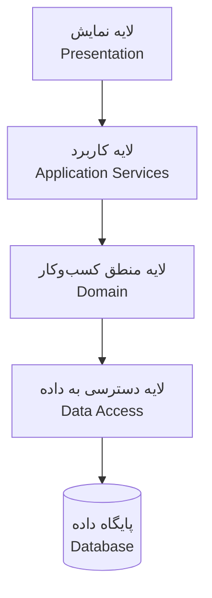

# جلسه پنجم: معماری نرم‌افزار و طراحی لایه‌ای

**موضوع پروژه:** سیستم مدیریت سالن آرایشی  
**هدف جلسه:** تعیین لایه‌های اصلی سامانه و مشخص کردن رابط‌های ارتباطی بین کامپوننت‌ها.

## ۱. انتخاب معماری

برای نسخه اولیه سیستم مدیریت سالن آرایشی، معماری لایه‌ای انتخاب شده است. در این روش، هر لایه مسئولیت مشخصی دارد و درخواست‌ها از مسیرهای تعریف‌شده بین لایه‌ها عبور می‌کنند. این انتخاب برای پروژه‌ای با اندازه متوسط مناسب است؛ زیرا جداسازی رابط کاربری، منطق کسب‌وکار و دسترسی به داده‌ها را ساده می‌کند.

## ۲. لایه‌های معماری

| لایه | مسئولیت | نمونه اجزا |
|---|---|---|
| Presentation (نمایش) | دریافت ورودی و نمایش نتیجه به کاربر | صفحات مشتری، پنل پذیرش، پنل مدیر |
| Application (کاربرد) | هماهنگ کردن مراحل هر سناریو | سرویس رزرو نوبت، سرویس لغو نوبت |
| Domain / Business (منطق کسب‌وکار) | اجرای قوانین اصلی سالن | قوانین تداخل زمانی، محاسبه مبلغ، وضعیت نوبت |
| Data Access (دسترسی به داده) | خواندن و ذخیره اطلاعات | مخزن مشتری، مخزن نوبت، مخزن پرداخت |
| Database (پایگاه داده) | نگهداری پایدار اطلاعات | جدول مشتری، خدمت، کارکنان، نوبت و پرداخت |

## ۳. نمودار معماری لایه‌ای



**توضیح مسیر:** برای مثال وقتی مشتری نوبت رزرو می‌کند، صفحه رزرو درخواست را به سرویس کاربردی می‌فرستد. سرویس، قوانین رزرو را در لایه منطق کسب‌وکار اجرا می‌کند و در صورت معتبر بودن، از طریق لایه دسترسی به داده اطلاعات را ذخیره می‌کند. نتیجه در مسیر برگشت به کاربر نمایش داده می‌شود.

## ۴. کامپوننت‌های اصلی

- **AppointmentService:** هماهنگ‌کننده ثبت، تغییر و لغو نوبت.
- **AvailabilityPolicy:** بررسی قواعد آزاد بودن بازه زمانی.
- **CustomerRepository:** دریافت و ذخیره اطلاعات مشتری.
- **ServiceRepository:** دریافت فهرست خدمات و مدت و قیمت آن‌ها.
- **StaffScheduleRepository:** دریافت برنامه کاری کارکنان.
- **PaymentService:** ثبت پرداخت مرتبط با نوبت.
- **ReportService:** آماده‌سازی گزارش‌های مدیریتی.

## ۵. رابط (Interface) کامپوننت‌ها

رابط مشخص می‌کند هر کامپوننت چه عملیاتی در اختیار سایر بخش‌ها قرار می‌دهد. این قراردادها نمونه مفهومی هستند و به زبان برنامه‌نویسی خاصی وابسته نیستند.

| رابط | عملیات | ورودی | خروجی |
|---|---|---|---|
| IAppointmentService | createAppointment | customerId, serviceId, staffId, startTime | نتیجه ثبت و appointmentId |
| IAppointmentService | cancelAppointment | appointmentId | وضعیت لغو |
| IAvailabilityService | getAvailableSlots | serviceId, staffId, date | فهرست زمان‌های آزاد |
| IAvailabilityService | isSlotAvailable | staffId, startTime, endTime | true یا false |
| ICustomerRepository | findById | customerId | اطلاعات مشتری یا عدم وجود |
| IServiceRepository | getActiveServices | بدون ورودی | فهرست خدمات فعال |
| IStaffScheduleRepository | getSchedule | staffId, date | برنامه کاری روز |
| IPaymentService | registerPayment | appointmentId, amount, method | شناسه پرداخت و وضعیت |
| IReportService | getRevenueReport | fromDate, toDate | گزارش درآمد بازه |

## ۶. نمونه قرارداد سرویس رزرو

```text
Interface: IAppointmentService

Operation: createAppointment
Inputs:
  customerId: شناسه مشتری
  serviceId: شناسه خدمت
  staffId: شناسه ارائه‌دهنده خدمت
  startTime: زمان شروع

Output:
  success: نتیجه عملیات
  appointmentId: شناسه نوبت در صورت موفقیت
  message: توضیح نتیجه یا خطا

Rules:
  - مشتری و خدمت باید معتبر باشند.
  - ارائه‌دهنده باید برای آن خدمت مجاز باشد.
  - زمان باید در برنامه کاری ارائه‌دهنده قرار داشته باشد.
  - بازه نباید با نوبت فعال دیگری هم‌پوشانی داشته باشد.
  - فقط پس از موفقیت ذخیره‌سازی، نتیجه موفق برگردانده شود.
```

## ۷. جریان نمونه درخواست رزرو در معماری

1. مشتری در لایه نمایش خدمت و زمان را انتخاب می‌کند.
2. لایه نمایش درخواست را به AppointmentService می‌فرستد.
3. سرویس کاربردی اطلاعات مشتری و خدمت را از مخزن‌های مربوط می‌گیرد.
4. قوانین کسب‌وکار و آزاد بودن زمان بررسی می‌شوند.
5. در صورت معتبر بودن درخواست، نوبت از طریق AppointmentRepository ذخیره می‌شود.
6. نتیجه عملیات به لایه نمایش برمی‌گردد.

## ۸. دلایل انتخاب معماری لایه‌ای

- مسئولیت هر بخش مشخص است.
- تغییر ظاهر صفحات الزاماً منطق رزرو را تغییر نمی‌دهد.
- دسترسی به پایگاه داده از منطق اصلی جدا می‌شود.
- آزمون سرویس‌ها و قوانین کسب‌وکار ساده‌تر می‌شود.
- در آینده می‌توان رابط کاربری وب یا موبایل دیگری به همان سرویس‌های کاربردی متصل کرد.

## ۹. جمع‌بندی

در این جلسه معماری لایه‌ای برای سامانه انتخاب شد. لایه‌های نمایش، کاربرد، منطق کسب‌وکار، دسترسی به داده و پایگاه داده تعریف شدند و برای کامپوننت‌های مهم رابط‌های اولیه در نظر گرفته شد. این معماری کمک می‌کند بخش‌های مختلف سامانه مستقل‌تر باشند و توسعه و نگهداری پروژه نظم بیشتری داشته باشد.

## منبع و ارتباط با درس

این مستند بر اساس سرفصل معماری نرم‌افزار و طراحی لایه‌ای و مباحث فصل‌های ۱۰ و ۱۱ کتاب Pressman & Maxim تهیه شده است.
